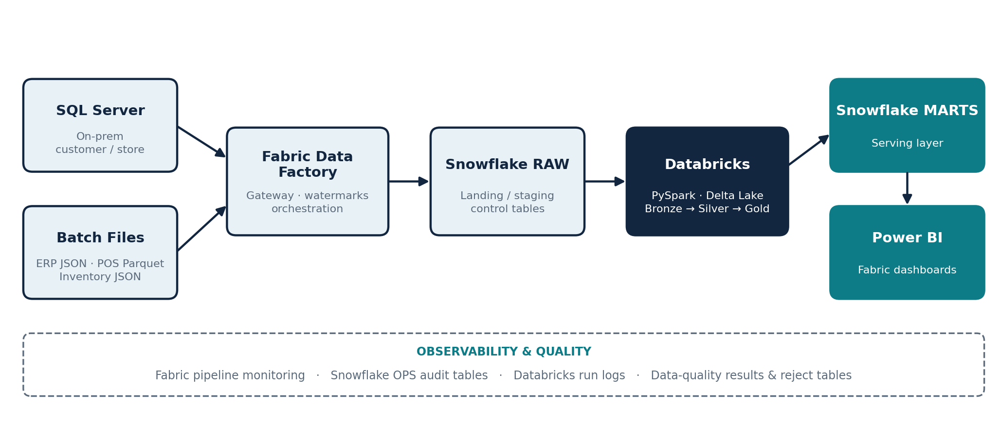
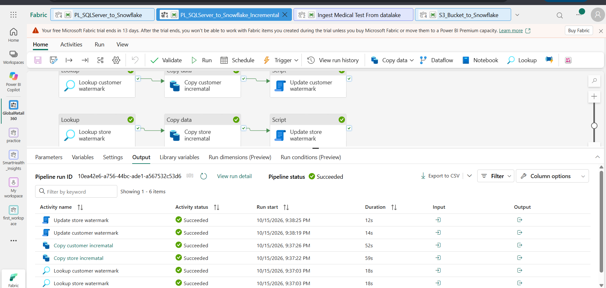
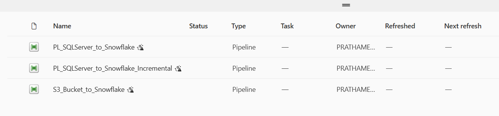
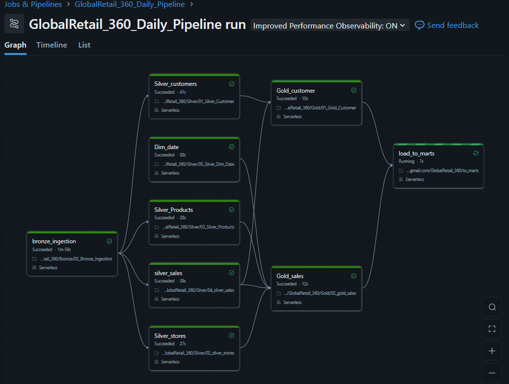
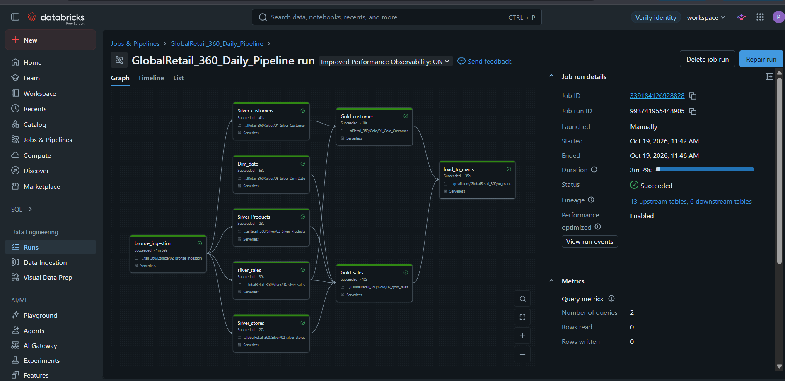

# 🛒 GlobalRetail 360

**A production-style batch data engineering platform for a multi-country retailer.**
SQL Server → Fabric Data Factory → Snowflake → Databricks (Medallion) → Snowflake Marts → Power BI


---

## 📌 Overview

GlobalRetail 360 consolidates omnichannel retail data (sales, inventory, customers, products) from multiple sources into one trusted analytical layer.

| Source | Origin / Format |
|---|---|
| Customer master | On-prem SQL Server, incremental table extract |
| Store master | On-prem SQL Server, incremental table extract |
| Product catalog | ERP export, JSON |
| Sales transactions | POS + e-commerce, Parquet |
| Inventory events | Operational export, batch JSON |

The source data is **deliberately dirty** (duplicates, invalid emails, inconsistent codes, negative stock), so the project demonstrates validation, quarantine of rejected records, dimensional modeling, history tracking and automated testing, not just moving clean data.

---

## 🏗️ Architecture



**Flow:** Fabric Data Factory ingests SQL Server and batch files into Snowflake RAW. A Databricks job reads RAW, builds the medallion layers in Delta, and publishes Gold marts to Snowflake MARTS. Power BI reads the marts. Snowflake acts as the exchange layer between Fabric and Databricks.

**Scope:** batch only. Low-stock monitoring is produced as batch exception reporting, not real-time alerts.

---

## 🧰 Tech Stack

| Area | Tools |
|---|---|
| Orchestration | Microsoft Fabric Data Factory, on-prem data gateway |
| Source | SQL Server, JSON / Parquet files |
| Warehouse | Snowflake (RAW, STAGING, OPS, MARTS) |
| Transformation | Databricks (PySpark, Delta Lake, Databricks Jobs) |
| BI | Power BI |
| Testing | pytest |

---

## 🔄 Ingestion & Incremental Load (Fabric Data Factory)

Customer and store data are loaded **incrementally using watermarks** instead of full reloads. Each entity follows the same 3-step pattern:

1. **Lookup** – read the last watermark from the Snowflake OPS `watermark_config` table
2. **Copy data** – extract only rows newer than the watermark (`updated_at` / `modified_at`) from SQL Server into Snowflake RAW
3. **Script** – update the watermark after a successful copy



*`PL_SQLServer_to_Snowflake_Incremental` — all six activities succeeded (lookup → copy → watermark update for both customer and store).*

### Pipelines

| Pipeline | Purpose |
|---|---|
| `PL_SQLServer_to_Snowflake` | Initial / full load of SQL Server tables into Snowflake RAW |
| `PL_SQLServer_to_Snowflake_Incremental` | Watermark-driven incremental load for customer and store |
| `S3_Bucket_to_Snowflake` | Loads JSON / Parquet batch files into Snowflake RAW |



### End-to-end orchestration

A master pipeline uses **Invoke Pipeline** activities to chain the incremental load and the file load, so ingestion runs as a single orchestrated flow. The Databricks transformation job runs only after ingestion succeeds.


---

## 🥉🥈🥇 Medallion Architecture (Databricks)

| Layer | Purpose | Key objects |
|---|---|---|
| **Bronze** | Append-only raw history as Delta tables | `customers_raw`, `stores_raw`, `products_raw`, `transactions_raw`, `inventory_events_raw` |
| **Silver** | Validated, conformed analytical entities | `dim_customer`, `dim_product`, `dim_store`, `dim_date`, `fact_sales`, `fact_inventory_event` |
| **Gold** | Business-ready consumption marts | `customer_analytics`, `inventory_alerts`, `sales_executive_mart` |
| **Ops** | Audit, watermarks, data quality | `watermark_config`, `notebook_run_log`, `data_quality_results`, reject tables |

### Databricks job: `GlobalRetail_360_Daily_Pipeline`

`bronze_ingestion` → five parallel Silver tasks (`Silver_customers`, `Silver_stores`, `Silver_Products`, `silver_sales`, `Dim_date`) → `Gold_customer` / `Gold_sales` → `load_to_marts`



**Successful run** — all tasks succeeded on serverless compute, total duration **3m 29s**.



---

## 📐 Dimensional Model

| Dimension | Pattern | Natural key | Surrogate key |
|---|---|---|---|
| `dim_customer` | SCD Type 2 | `customer_id` | `customer_sk` |
| `dim_product` | SCD Type 2 | `product_id` | `product_sk` |
| `dim_store` | Type 1 | `store_id` | `store_sk` |
| `dim_date` | Static | `calendar_date` | `date_key` |

| Fact | Grain | Measures |
|---|---|---|
| `fact_sales` | `order_id` + `order_line_id` | quantity, gross_amount, net_amount, usd_net_amount, gross_margin_amount |
| `fact_inventory_event` | `event_id` | delta_qty, on_hand_after |

### SCD Type 2 logic

1. Deduplicate to the latest record per natural key (`updated_at` + ingestion timestamp)
2. Compute a hash over the historized attributes
3. Compare with the current dimension row
4. If the hash differs → close the old row (`effective_end_ts` set, `is_current = false`) and insert a new current row with a new surrogate key
5. Resolve each fact to the dimension version valid at its event time

---

## ✅ Data Quality Rules (Bronze → Silver)

| Rule | Handling |
|---|---|
| Customer email validity | Invalid rows written to `customers_rejects` |
| Country & currency standardization | Normalize codes (e.g. `USA` → `US`, `UK` → `GB`) |
| Latest-record deduplication | Keep latest by `order_id + order_line_id`, or by `event_id` |
| Quantity & key validation | Reject zero quantity, null `product_id`, null `store_id` |
| Inventory sanity | Reject negative `on_hand_after` |
| Channel standardization | Map `WEB`, `web`, `Online` into a controlled vocabulary |

---

## 📊 Gold Marts & Dashboards

| Mart | Content |
|---|---|
| `customer_analytics` | Repeat-purchase behavior, loyalty tiers, customer value |
| `inventory_alerts` | Low-stock, out-of-stock and inventory exception analysis |
| `sales_executive_mart` | Daily sales, regional / channel performance, gross margin, order KPIs |

Power BI connects to the Snowflake `MARTS` schema. Pages: Executive Overview · Sales Performance · Customer & Loyalty · Product Performance · Inventory Alerts.

---

## 🔍 Observability & Testing

- **Fabric Data Factory:** pipeline and activity run monitoring
- **Snowflake OPS:** `watermark_config`, `pipeline_audit`, `activity_audit`, `data_quality_results`
- **Databricks:** `notebook_run_log` (run_id, step, input/output/rejected counts, status, errors, timestamps)
- **Tests:** business rules live in `src/` modules with `pytest` tests in `tests/` covering normalization, mappings, sales/margin formulas, inventory alert classification, SCD2 change detection and deduplication

```bash
pip install -r requirements.txt
pytest tests/
```

---

## 🗂️ Repository Structure

```
Global_Retail_360/
├── README.md
├── doc/                        # architecture diagram & pipeline screenshots
├── sql_server/                 # source tables + dirty sample data
├── snowflake/                  # RAW / STAGING / OPS / MARTS DDL
├── fabric/                     # Data Factory pipeline definitions
├── databricks/
│   ├── Bronze/
│   ├── Silver/
│   └── Gold/
├── src/                        # reusable business-rule modules
└── tests/                      # pytest suite
```

> Adjust folder names to match the repo.

---

## 🚀 How to Run

1. Create the SQL Server source tables and load the sample (dirty) data
2. Create Snowflake databases and schemas (`RAW`, `STAGING`, `OPS`, `MARTS`) and the watermark / audit tables
3. Install the on-prem data gateway and create the SQL Server connection in Fabric
4. Run `PL_SQLServer_to_Snowflake` once, then schedule `PL_SQLServer_to_Snowflake_Incremental` and `S3_Bucket_to_Snowflake`
5. Run the Databricks job `GlobalRetail_360_Daily_Pipeline`
6. Connect Power BI to the Snowflake `MARTS` schema

> Databricks Free Edition and Snowflake trial credits have usage limits, so synthetic data volumes are kept modest.

---

## 🎯 Skills Demonstrated

- Orchestration with Fabric Data Factory (gateway, watermark-driven incremental loads)
- PySpark / SQL transformations on Databricks with Delta Lake and medallion layering
- Star schema, conformed dimensions, SCD Type 2, surrogate keys
- Data quality: validation rules, reject tables, DQ result logging
- Snowflake schemas, `MERGE`, role-based access
- Reusable modules, pytest suite, audit and run logging
- Power BI dashboards on curated marts

---

## 👤 Author

**Prathamesh Upreti** — Data Engineer / Data Analyst
[GitHub](https://github.com/PrathameshUpreti)
